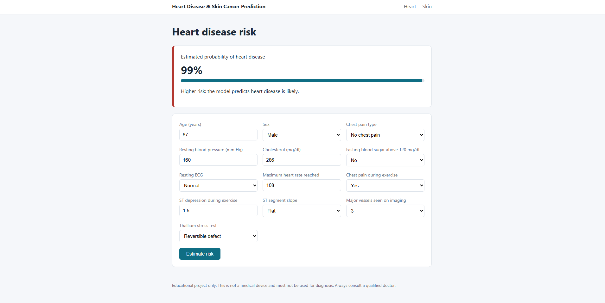
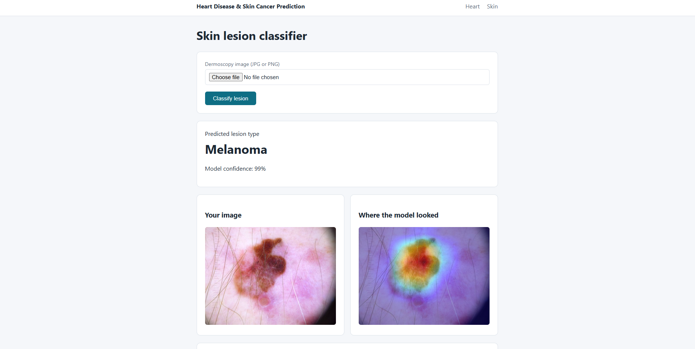
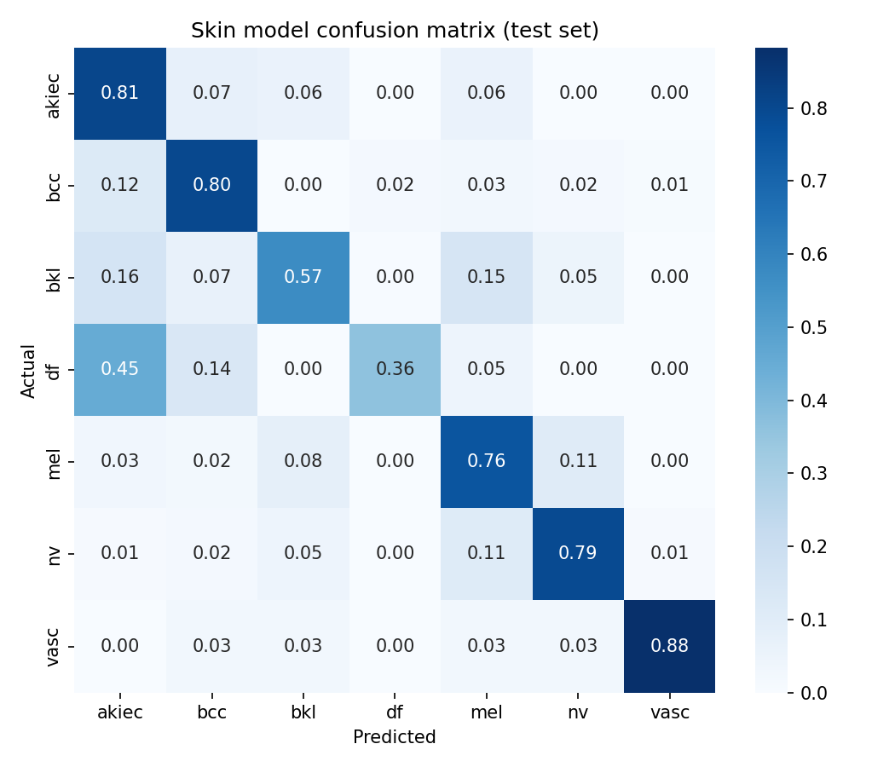

# Heart Disease & Skin Cancer Prediction

Two machine learning models served through one Flask web app:

- **Heart disease risk** from 13 clinical measurements (scikit-learn)
- **Skin lesion classification** from dermoscopy images, with Grad-CAM heatmaps showing where the model looked (PyTorch)

> **Disclaimer:** This is an educational project. It is not a medical device and must not be used for diagnosis.

## Demo

| Heart disease risk | Skin lesion classifier |
|---|---|
|  |  |

## Results

### Heart disease (UCI Cleveland, 303 patients)

Logistic regression, chosen over random forest by 5-fold cross-validation.

| Metric | Cross-validation | Test set (61 patients) |
|---|---|---|
| ROC AUC | 0.906 | 0.958 |
| Accuracy | 0.847 | 0.87 |
| Recall (disease) | 0.784 | 0.93 |

The test set is small, so the cross-validation figures are the more reliable estimate.

### Skin lesions (HAM10000, 10,015 images, 7 classes)

EfficientNet-B0 fine-tuned for 10 epochs on a free Colab T4 GPU.

| Metric | Test set (2,014 images) |
|---|---|
| Balanced accuracy | 0.711 |
| Accuracy | 0.765 |
| Melanoma recall | 0.76 |
| Melanoma precision | 0.46 |

| Class | Precision | Recall |
|---|---|---|
| Actinic keratosis (akiec) | 0.42 | 0.81 |
| Basal cell carcinoma (bcc) | 0.59 | 0.80 |
| Benign keratosis (bkl) | 0.57 | 0.57 |
| Dermatofibroma (df) | 0.53 | 0.36 |
| Melanoma (mel) | 0.46 | 0.76 |
| Melanocytic nevus (nv) | 0.97 | 0.79 |
| Vascular lesion (vasc) | 0.65 | 0.88 |



## Design decisions

- **Leak-free split.** HAM10000 has 10,015 images of only 7,470 lesions. Splitting by image puts photos of the same lesion in both train and test and inflates scores, so the data is split by lesion (`StratifiedGroupKFold`).
- **Class imbalance.** 67% of images are common moles. The loss is class-weighted and models are selected on balanced accuracy, not plain accuracy.
- **Test set used once.** Model selection uses cross-validation (heart) or a validation set (skin). The test set is only touched for the final report.
- **Explainability.** Grad-CAM heatmaps show which part of the image drove each prediction.
- **Privacy.** Uploaded images are processed in memory and never written to disk.
- **No false certainty.** Displayed probabilities are capped at 99%.

## Limitations

- The skin model misses about 1 in 4 melanomas and about half of its melanoma alerts are false alarms.
- Dermatofibroma performance is poor (about 80 training images).
- HAM10000 images come from two sites (Austria and Australia), so performance on other skin tones and cameras is unknown.
- The heart dataset is small (303 patients from one hospital, collected in the 1980s).

## Project structure

```
app/            Flask app and templates
src/heart/      download, explore, train, predict
src/skin/       predict, Grad-CAM
notebooks/      Colab training notebook for the skin model
models/         trained models
reports/        figures
samples/        example dermoscopy images
tests/          pytest tests
```

## Run it locally

```bash
git clone https://github.com/chisomcyprian/heart-disease-skin-cancer-prediction.git
cd heart-disease-skin-cancer-prediction
python -m venv .venv
.\.venv\Scripts\Activate.ps1        # macOS/Linux: source .venv/bin/activate
pip install -r requirements.txt
python -m flask --app app.app run
```

Open http://127.0.0.1:5000. Try the images in `samples/` on the Skin page.

To retrain the heart model:

```bash
python src/heart/download_data.py
python src/heart/train.py
```

To retrain the skin model, open `notebooks/skin_cancer_training.ipynb` in Google Colab with a GPU runtime.

## Tests

```bash
python -m pytest -v
```

## Data and credits

- **Heart Disease dataset**: Janosi, Steinbrunn, Pfisterer and Detrano (1989), UCI Machine Learning Repository.
- **HAM10000**: Tschandl, Rosendahl and Kittler (2018), Scientific Data 5, 180161. Licensed CC BY-NC 4.0; the sample images in this repo are from this dataset.